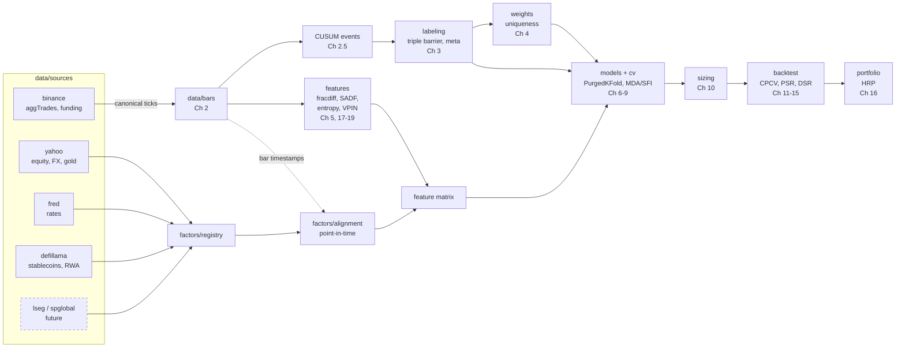

# Architecture

**Trade crypto, condition on everything else.** Crypto is the only traded universe; equities, rates, FX, commodities, stablecoins and tokenized RWAs enter only as factor inputs.

## Design rules

1. **Canonical schemas** (`data/schema.py`). Every source converts to one tick frame (`price, volume, side`) or one daily frame (`open, high, low, close, volume`). Algorithms never know which venue the data came from.
2. **Targets ≠ factors.** `factors/registry.py` declares `TARGETS` (what we label and trade) separately from `FACTORS` (what we condition on). Adding an asset class means adding registry rows, not new code paths.
3. **Point-in-time by construction.** Each factor declares a publication `lag`; `factors/alignment.py` shifts by that lag before forward-filling onto 24/7 crypto bars. This is the mixed-frequency equivalent of the book's purging: no factor value reaches a bar before it was knowable.
4. **Library ≠ UI.** All math lives in `src/afml_lab` and is unit-tested; `app/` only calls it and draws charts.
5. **Swappable sources.** Free proxies today (Yahoo, FRED, DefiLlama); when institutional feeds arrive, add `data/sources/lseg.py` and change the factor's `source` field.

## Research question the app answers

> Given crypto-native signals, do cross-asset factors (dollar, real yields, equity risk appetite, stablecoin liquidity, tokenized treasury flows) improve a meta-labeled crypto strategy **after** purged CV and deflated Sharpe?

Chapter 8 feature importance (MDA / SFI with clustered features) answers which factors matter; Chapter 14 DSR answers whether the improvement survives the number of trials.
